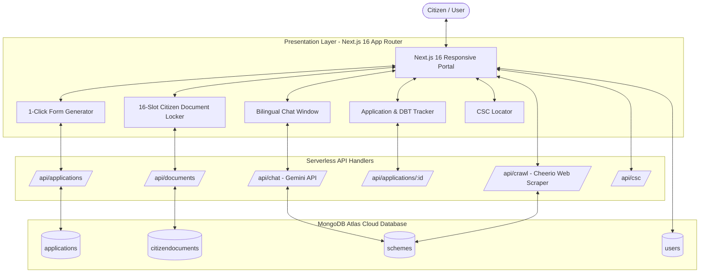

# 🏛️ Government Scheme Assistance Bot (Sahayog - National Citizen Welfare Portal)

[](https://nextjs.org/)
[](https://react.dev/)
[](https://www.typescriptlang.org/)
[](https://www.mongodb.com/atlas)
[](https://ai.google.dev/)

An end-to-end, AI-powered multilingual citizen welfare platform that simplifies discovery, eligibility evaluation, document readiness, 1-click application generation, and live milestone & Direct Benefit Transfer (DBT) tracking across Central and State Government schemes in India.

---

## 📋 Table of Contents
- [Project Overview](#-project-overview)
- [Key Features](#-key-features)
- [System Architecture](#-system-architecture)
- [Tech Stack](#-tech-stack)
- [Directory Structure](#-directory-structure)
- [Getting Started](#-getting-started)
- [API Reference](#-api-reference)
- [Academic Declaration](#-academic-declaration)

---

## 🎯 Project Overview
Navigating government welfare programs in India is often hindered by fragmented portals, complex eligibility criteria, language barriers, and lack of transparent application tracking. 

The **Government Scheme Assistance Bot** solves these challenges by providing:
1. **Intelligent Scheme Discovery:** Matches citizen demographic and socio-economic profiles against 38+ verified central and state schemes.
2. **Dual-Language Accessibility:** Seamless real-time bilingual support in **English and Hindi (हिंदी)**.
3. **Citizen Document Vault:** A 16-slot document locker with simulated OCR verification for core Indian identity, income, caste, land, and disability records.
4. **1-Click Application Form Generator:** Generates official government application forms with verifiable application reference numbers (`GOV-XXXX-2026-XXXXX`), ready for download and print.
5. **Real-Time DBT & Milestone Tracker:** Fully connected to MongoDB Atlas with live 5-stage scrutiny and milestone progression.
6. **Live Portal Synchronization:** Built-in web crawler targeting MyScheme, DBT Bharat, and India.gov.in for real-time scheme ingestion.

---

## 🌟 Key Features

### 1. 🤖 Conversational AI Assistant & Profile Matching
- Powered by **Google Gemini API** (`@google/genai`).
- Multi-turn conversation maintaining user context and eligibility criteria.
- Dynamic filtering by **Age, Gender, State, Annual Income, Social Category (General/OBC/SC/ST), and Occupation**.

### 2. 📁 Citizen Document Locker & OCR Ingestion
- Includes 16 official citizen document categories:
  - Aadhaar Card, PAN Card, Income Certificate, Caste Certificate
  - Land Records (Patta/Khatoni), Ration Card, Domicile Certificate
  - Kisan Credit Card (KCC), e-Shram Card, Disability Certificate (UDID)
  - Bank Passbook, Voter ID (EPIC), MGNREGA Job Card, Birth Certificate, etc.
- Ingests PDF and image uploads, parses metadata, extracts profile attributes, and computes cryptographic verification checksums.
- Per-citizen scoping stored directly in MongoDB Atlas.

### 3. 📝 1-Click Pre-Filled Application Generator
- Instantly creates pre-filled official welfare scheme application forms.
- Formats applicant details, masked Aadhaar, eligibility criteria declarations, and required document checklists.
- Automatically saves the newly generated application to MongoDB Atlas with an official Reference ID.
- Provides one-click text download, print / save as PDF, and direct tracking link.

### 4. 🚚 Application Status & DBT Milestone Tracker
- Tracks real-time administrative progress across 5 official stages:
  1. *Stage 1:* Application Submitted & CSC Acknowledgement Slip Issued
  2. *Stage 2:* Field Officer Document Verification & Scrutiny
  3. *Stage 3:* Sanction & Approval by Competent Authority (Tehsildar / DWO)
  4. *Stage 4:* PFMS Validation & Bank Account NPCI Seeding
  5. *Stage 5:* Direct Benefit Transfer (DBT) Grant Disbursement
- **Strict Database Validation:** Querying an invalid reference ID returns `404 Not Found` (zero dummy fallbacks).
- **Interactive Database Updates:** Users and officials can advance milestone stages and withdraw/delete applications directly from the database.

### 5. 🌐 Web Crawler & Portal Synchronization
- Scrapes and parses open scheme records from **MyScheme.gov.in**, **dbtbharat.gov.in**, and **india.gov.in**.
- Merges newly discovered schemes into MongoDB Atlas without deleting existing validated entries.

### 6. 🗺️ Common Service Center (CSC) Locator
- Locates nearby physical citizen service centers with VLE officer contacts, pinpoint addresses, and distance approximations.

---

## 🏗️ System Architecture



---

## 🛠️ Tech Stack

| Component | Technology | Description |
|-----------|------------|-------------|
| **Framework** | Next.js 16.2.9 | App Router, Server Components & Route Handlers |
| **Frontend Library** | React 19 | Client state management & responsive UI |
| **Language** | TypeScript 5 | Strict static typing across schemas and APIs |
| **AI LLM** | Google Gemini API (`@google/genai`) | Contextual eligibility search & multilingual NLP |
| **Database** | MongoDB Atlas | Cloud NoSQL database with Mongoose ODM |
| **Web Scraping** | Cheerio & Axios | Scraping national government portals |
| **Styling** | Vanilla CSS Design System | Responsive, Accessible, Dark/Light Mode support |

---

## 📁 Directory Structure

```
├── public/                     # Static SVG icons and favicon
├── src/
│   ├── app/
│   │   ├── api/
│   │   │   ├── applications/   # Application creation, listing, tracking & deletion
│   │   │   │   └── [id]/       # Single application query, PATCH milestone & DELETE
│   │   │   ├── auth/           # Aadhaar OTP simulation & profile authentication
│   │   │   ├── chat/           # Gemini API chat streaming & response generation
│   │   │   ├── crawl/          # Web crawler for live scheme ingestion
│   │   │   ├── csc/            # CSC directory & location search
│   │   │   ├── documents/      # Citizen document locker vault CRUD
│   │   │   ├── schemes/        # Scheme retrieval & criteria filtering
│   │   │   ├── seed/           # Database seeder with 30+ core national schemes
│   │   │   └── threads/        # Citizen chat thread persistence
│   │   ├── globals.css         # Portal design system & CSS variables
│   │   ├── layout.tsx          # Root layout & theme initialization
│   │   └── page.tsx            # Main application dashboard & views
│   ├── components/             # Reusable UI Components
│   │   ├── ApplicationFormModal.tsx
│   │   ├── ApplicationTrackerModal.tsx
│   │   ├── ChatWindow.tsx
│   │   ├── CSCLocator.tsx
│   │   ├── DocumentChecklistModal.tsx
│   │   ├── DocumentLockerModal.tsx
│   │   ├── DocumentLockerSection.tsx
│   │   ├── DocumentScannerModal.tsx
│   │   ├── Navbar.tsx
│   │   ├── ProfilePanel.tsx
│   │   ├── SchemeCard.tsx
│   │   └── TypingIndicator.tsx
│   ├── lib/                    # Core utilities & services
│   │   ├── application-tracker.ts
│   │   ├── citizen-documents.ts
│   │   ├── crawler.ts
│   │   ├── csc-locator.ts
│   │   ├── document-scanner.ts
│   │   ├── dynamic-crawler.ts
│   │   ├── gemini.ts
│   │   ├── matcher.ts
│   │   ├── mongodb.ts
│   │   └── schemes-seed.ts
│   ├── models/                 # Mongoose Data Models
│   │   ├── Application.ts
│   │   ├── CitizenDocument.ts
│   │   ├── Scheme.ts
│   │   ├── Thread.ts
│   │   └── User.ts
│   └── types/                  # TypeScript interface definitions
├── .env.example                # Example environment variables template
├── .gitignore                  # Git ignore rules (protects credentials)
├── next.config.ts              # Next.js build configuration
├── package.json                # Project dependencies and npm scripts
└── tsconfig.json               # TypeScript compiler options
```

---

## 🚀 Getting Started

### 1. Clone Repository
```bash
git clone https://github.com/Priyanshu07190/Government-Scheme-Assistance-Bot.git
cd Government-Scheme-Assistance-Bot
```

### 2. Install Dependencies
```bash
npm install
```

### 3. Configure Environment Variables
Copy `.env.example` to `.env.local`:
```bash
cp .env.example .env.local
```
Add your credentials inside `.env.local`:
```env
MONGODB_URI=your_mongodb_connection_string
GEMINI_API_KEY=your_gemini_api_key
```

### 4. Start Development Server
```bash
npm run dev
```
Open **[http://localhost:3000](http://localhost:3000)** in your browser.

---

## 📡 API Reference

### Applications
| Method | Endpoint | Description |
|--------|----------|-------------|
| `GET` | `/api/applications` | List applications (filter by Aadhaar or name) |
| `POST` | `/api/applications` | Create and save a new application in MongoDB |
| `GET` | `/api/applications/:id` | Lookup application by ID (returns 404 if not found) |
| `PATCH` | `/api/applications/:id` | Advance application milestone stage in MongoDB |
| `DELETE` | `/api/applications/:id` | Withdraw and delete application from MongoDB |

### Documents
| Method | Endpoint | Description |
|--------|----------|-------------|
| `GET` | `/api/documents?aadhaar=...` | Fetch citizen's verified documents |
| `POST` | `/api/documents` | Save or update verified document in database |
| `DELETE` | `/api/documents?type=...` | Remove a document from database |

### Live Crawler & Chat
| Method | Endpoint | Description |
|--------|----------|-------------|
| `POST` | `/api/crawl` | Trigger live scraping from national portals |
| `POST` | `/api/chat` | AI conversational response via Gemini |

---

## 🎓 Academic Declaration
This project is developed as a final-semester engineering capstone project demonstrating modern agentic AI integration, production-grade Next.js architecture, and digital public infrastructure (DPI) for Indian citizen welfare delivery.
